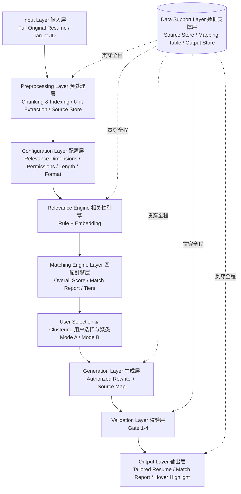

英文名：TrueFit
中文名：简旨
定位：基于真实经历，只留跟这份工作最相关的
slogan：给简历捡旨（减脂）
> 输入完整原始简历 + 目标 JD，输出瘦身简历 + 匹配报告，全程可追溯。

## 1. Input Layer 输入层

|组件|说明|
|---|---|
|Full Original Resume|完整原始简历，必须全面，作为唯一事实源|
|Target JD|目标岗位描述|

---

## 2. Preprocessing Layer 预处理层

|组件|说明|
|---|---|
|Chunking & Indexing|原文切块 + 编号（W1/P1）|
|Unit Extraction|提炼经历单元：按业务主题归类合并、去重、统一粒度|
|Source Store|原文库|

---

## 3. Configuration Layer 配置层

|组件|说明|
|---|---|
|Relevance Dimension Configuration|相关性维度配置|
|├─ Selectable Dimensions|技能 / 内容 / 行业 / 资历|
|├─ Adjustable Weights|权重可调（仅对已勾选项）|
|├─ Presets|通用 / 技术 / 管理 / 校招 / 系统自动判断 / 用户自定义|
|└─ Unchecked = Weight 0|取消勾选 = 权重置 0|
|Operation Permissions|7 开关 → 预设模式 / 自定义|
|├─ verbatim|原文保留|
|├─ compress|压缩|
|├─ reword|改写|
|├─ reorder|重排|
|├─ merge|合并|
|├─ demote|降级|
|└─ omit|省略|
|Length|篇幅（自动 / 指定）|
|Output Format|输出格式|

---

## 4. Relevance Engine 相关性引擎（核心）

|组件|说明|
|---|---|
|Input|单条经历 vs JD|
|Scoring|按配置的维度权重打分|
|Dimensions|技能 / 内容 / 行业 / 资历|
|Base|规则 + 语义相似度（embedding）|
|Safety Rules（固定不可调）|防编造 / 贡献动词门槛 / 事实校验|
|Output|每条经历的相关度分 → 驱动分层|

---

## 5. Matching Engine Layer 匹配引擎层

|组件|说明|
|---|---|
|Overall Match Score|整体匹配分（由每条经历相关度加权汇总）|
|Match Report|匹配报告生成（命中 / 缺口 / 建议）—— **纯规则生成，不调LLM**|
|Tiering|每段经历 → 相关度分层（核心 / 相关 / 其他）|

---

## 6. User Selection & Clustering 用户选择与聚类

|模式|说明|
|---|---|
|Mode A 用户自定义|用户勾选 + 手动聚类（拖拽合并 / 勾选合并）|
|Mode B 一键生成|系统全选 + 自动聚类（按主题合并）|

---

## 7. Generation Layer 生成层

> 核心：按权限执行 + 同步埋 source map

|组件|说明|
|---|---|
|Authorized Rewrite|仅在用户授权的操作范围内改写|
|Source Mapping|每条输出绑定 source_ids + operation|
|Validation|无 source_ids 的条目 → 拦截 / 标红|

---

## 8. Validation Layer 校验层

|门禁|说明|
|---|---|
|Gate 1|source_ids 必须真实存在|
|Gate 2|公司名/时间/职位不能被改|
|Gate 3|operation 在允许列表内|
|Gate 4|text 里的数字、贡献动词、事实性名词必须在原文找到；不通过则回退原文|

---

## 9. Output Layer 输出层

|组件|说明|
|---|---|
|Tailored Resume|瘦身简历（分层：核心 / 相关 / 其他）|
|├─ Editable Template|可编辑模板，最终稿归用户|
|Match Report|匹配报告（默认折叠，可展开）|
|Hover Highlighting|悬停高亮（输出 ↔ 原文 双向对应）|
|├─ AI items|AI 条目：有映射|
|└─ user_edited|无映射|

---

## 10. Data Support Layer 数据支撑层

> 贯穿全程，非独立阶段

|组件|说明|
|---|---|
|Source Store|原文库|
|Mapping Table|输出 ↔ 原文 映射表|
|Output Store|输出库（含 origin 字段）|

---

## Key Design Principles 关键设计原则

1. **Single Source of Truth** — 完整原始简历是唯一事实源。
2. **Traceability** — 每条 AI 输出必须绑定 source_ids + operation。
3. **Safety First** — 防编造、贡献动词门槛、事实校验固定不可调。
4. **User Authority** — 用户手改即脱离映射，标记 user_edited。
5. **Configurable Relevance** — 维度可勾选、权重可调、预设可切换。
6. **Rule First** — 能规则化的（打分、分层、报告）不用 LLM。